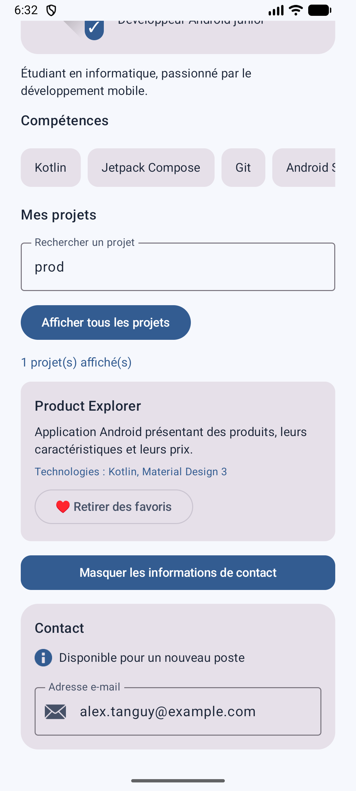
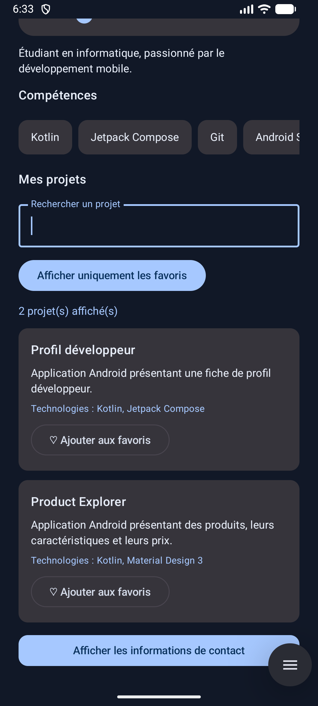

# DeveloperProfileInteractive — Profil développeur interactif

Application Android de portfolio développée en **Kotlin** avec **Jetpack Compose** et **Material Design 3**. Elle reprend la fiche de profil du précédent devoir (`DeveloperProfile-CC2`) et ajoute des interactions locales pour consulter et filtrer les projets.

Le profil présenté est fictif : **Alex TANGUY**, développeur Android junior. Les données restent dans le code ; l'application ne communique avec aucune API et n'utilise pas de base de données.

## Fonctionnalités

- **Présentation du profil** : avatar, nom, rôle et description.
- **Compétences** : liste horizontale défilante avec `LazyRow`.
- **Projets** : liste verticale avec `LazyColumn`, titre, description et technologies. Deux projets de démonstration sont fournis : *Profil développeur* et *Product Explorer*.
- **Recherche en direct** : filtrage des projets par titre, description ou technologie, sans distinction entre majuscules et minuscules.
- **Favoris** : ajout et retrait d'un projet avec un bouton dédié.
- **Filtre « Favoris uniquement »** : affichage des projets favoris, combinable avec la recherche.
- **Compteur de résultats** : nombre de projets actuellement visibles.
- **Contact** : bouton permettant d'afficher ou masquer la disponibilité et une adresse e-mail fictive en lecture seule.
- **Thèmes clair et sombre** : couleurs, typographies et composants Material Design 3.
- **Deux previews Compose** : présentation d'états différents sans exécuter le ViewModel.

## Architecture et gestion des états

L'interface sépare la gestion des données de leur affichage :

```text
MainActivity
    └── ProfileContainer (Stateful)
          ├── ProfileViewModel
          │     └── MutableStateFlow<ProfileUiState>
          └── ProfileScreen (Stateless)
                ├── ProfileHeader
                ├── SkillCard (LazyRow)
                ├── ProjectCard (LazyColumn)
                └── ContactDisclosure
                      └── ContactInfo
```

### `ProfileViewModel.kt`

- `ProfileUiState` regroupe `visibleProjects`, `searchQuery`, `showOnlyFavorites` et `favoriteProjectIds`.
- Le ViewModel conserve un `MutableStateFlow` privé et expose un `StateFlow` en lecture seule avec `asStateFlow()`.
- `onSearchQueryChange()`, `onToggleFavoriteFilter()` et `onFavoriteClick()` modifient l'état avec `update()` et `copy()`.
- `filterProjects()` combine la recherche avec le filtre favoris. Les favoris sont identifiés par l'`id` de chaque projet.

### `MainActivity.kt`

- `ProfileContainer` observe le flux grâce à `collectAsState()` et transmet les valeurs et les callbacks à `ProfileScreen`.
- `ProfileScreen` et `ProjectCard` reçoivent leurs données en paramètres : ils n'hébergent pas les états de recherche et de favoris (**State Hoisting**).
- `ContactDisclosure` gère uniquement son état local `showContact` avec `rememberSaveable`.
- `sampleProjects()` fournit les données de démonstration.

**Comportement des états :** le ViewModel conserve la recherche, le filtre et les favoris pendant une rotation de l'écran. `rememberSaveable` conserve l'affichage du contact lors d'une recréation de l'activité. Il n'y a pas d'enregistrement permanent des favoris après un arrêt complet de l'application.

## Technologies et composants

- Kotlin, Android Studio, Jetpack Compose et Material Design 3.
- `ViewModel`, `MutableStateFlow`, `StateFlow`, `collectAsState()` et `rememberSaveable`.
- `LazyColumn`, `LazyRow`, `Column`, `Row`, `Box`, `Spacer`, `Card` et `Surface`.
- `Text`, `Image`, `Icon`, `Button`, `OutlinedButton` et `OutlinedTextField`.

## Lancer l'application

1. Cloner le dépôt :

   ```bash
   git clone https://github.com/AlexTng44000/DeveloperProfileInteractive.git
   ```

2. Ouvrir le dossier `DeveloperProfileInteractive` dans Android Studio.
3. Laisser Gradle se synchroniser (**Sync Project with Gradle Files**).
4. Sélectionner un émulateur Android (API 24 minimum).
5. Lancer la configuration **app** avec **Run**.

Pour vérifier la compilation depuis un terminal à la racine du projet :

```bash
./gradlew assembleDebug
```

## Scénarios de test manuel

| Action | Résultat attendu |
| --- | --- |
| Ouvrir l'application | Profil, compétences et 2 projets visibles |
| Rechercher `Product` | Seul *Product Explorer* apparaît |
| Rechercher `Kotlin` | Les 2 projets apparaissent |
| Rechercher un texte absent | Message « Aucun projet correspondant. » et compteur à 0 |
| Ajouter puis retirer un favori | Le libellé et le cœur du bouton changent |
| Activer « Afficher uniquement les favoris » | Seuls les projets favoris restent visibles |
| Associer recherche et filtre favoris | Le compteur suit les résultats combinés |
| Afficher puis masquer le contact | La carte de contact apparaît puis disparaît |
| Faire pivoter l'émulateur | Recherche, filtre et favoris restent conservés |
| Ouvrir les previews | Versions claire et sombre affichées |

## Previews Compose

Deux fonctions `@Preview` figurent dans `MainActivity.kt` :

- `ProfilePreview` : Alex TANGUY, thème clair, deux projets visibles.
- `SecondProfilePreview` : Camille Durand, thème sombre, filtre favoris actif et recherche préremplie.

## Captures d'écran

Les images ci-dessous proviennent du précédent devoir et illustrent les palettes Material Design 3 conservées dans cette version :

| Thème clair | Thème sombre |
| --- | --- |
|  |  |

**Pour documenter cette version interactive :** ajouter une capture de l'émulateur montrant la recherche, le filtre, les favoris et le compteur, par exemple sous `screenshots/profil-interactif.png`, puis insérer son lien dans cette section.

## Limites

L'application utilise uniquement des données locales de démonstration. Elle n'intègre ni API distante, ni base de données, ni système de navigation. Les coordonnées du profil sont fictives. La sélection des favoris est conservée en mémoire pendant l'utilisation, sans stockage permanent.

## Dépôt précédent

Le projet initial du CC2 reste disponible séparément : [DeveloperProfile-CC2](https://github.com/AlexTng44000/DeveloperProfile-CC2).
